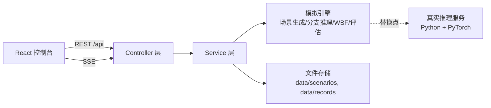

# 演示平台重建方案

## 1. 要解决的问题

原演示包（`04_演示系统代码包/TrafficObjectDetection`）无法在本机运行，原因已核到具体位置，见 [盘点 §3](../09-历史与证据/01-原交付包盘点与归属登记.md)：硬编码的他人 Python 路径、不存在的 `data/` 目录、缺失的 `.pt` 权重、以及一个只返回写死 10 条结果的"模拟"方法。

同时项目真实能力是明确的：VEDAI 双模态检测，5 类目标（car / truck / bus / van / freight_car），WBF 融合多分支结果，mAP50 0.836。演示平台要让人**在不装 PyTorch、不下载权重的前提下**看到这套流程跑起来。

## 2. 目标与非目标

目标：

- 双击脚本即可启动，零 Python、零权重依赖。
- 检测链路结构真实：三支路推理 → 加权框融合 → 评估，参数取自真实实验配置。
- 结果稳定可复现：同一场景重复检测得到同一份结果，便于答辩讲解与截图。
- 演示三条主线：单次检测、批量任务、实时日志。

非目标（明确不做）：

- 不做真实推理，不引入 torch / ultralytics，不下载数据集。
- 不做训练、不做数据集浏览页、不做指标看板页（真实数值只用于生成模拟置信度）。
- 不做用户体系、权限、数据库；存储用文件系统。
- 不修改交付包 `01_`～`04_`。

## 3. 技术栈

| 层 | 选型 | 说明 |
| --- | --- | --- |
| 后端 | Spring Boot 3.2.0 / Java 17 | 沿用现有 parent，只保留 `starter-web`，移除 `thymeleaf` 与 `org.json`（改用 Jackson） |
| 前端 | React 18 + TypeScript 5 + Vite 5 + Tailwind CSS 3.4.17 | Tailwind 走 PostCSS；组件用 shadcn 风格本地实现 + Radix 原语；图标用 lucide-react |
| 构建 | Maven 3.9.9（脚本引导）、npm 10 | 本机无 Maven，首次构建需联网 |
| 存储 | `data/` + JSON 文件 | 无数据库；历史上限 500 条 |

## 4. 架构

分层职责：

| 层 | 允许做什么 | 不允许做什么 |
| --- | --- | --- |
| `web` | 参数校验、DTO 映射、SSE 建流、HTTP 语义 | 写业务算法、直接读文件 |
| `service` | 编排、状态流转、持久化、导出 | 持有 HTTP 类型 |
| `engine` | 纯计算：生成/推理模拟/融合/评估 | 依赖 Spring 上下文、读写 HTTP |

## 5. 模拟引擎（"虚接"的边界）

### 5.1 场景生成

- 1024×1024，`java.awt` 分层绘制：草地/土壤底噪 → 沥青路面与车道虚线 → 建筑楼顶与阴影 → 树冠 → 车辆（车体 + 阴影 + 风挡高光）。
- 红外图为同几何的灰度版本：背景压暗，车辆作为热源亮斑，叠加低频噪声与轻微配准偏移（≤1px，模拟真实双光相机）。
- 输出 `data/scenarios/SC-xxx_rgb.png`、`SC-xxx_ir.png`、`SC-xxx.json`（含 `objects` 真值与天气、密度、地形）。
- 以场景编号为随机种子：同一编号每次生成一致，可复现。
- 首次启动生成 10 个场景（城郊路口、停车场、夜间巡逻、田埂土路等），失败可重生成。

### 5.2 分支推理

三支路，与真实实验配置对齐：

| 分支 | 组成 | 权重 | 召回基线 | 特性 |
| --- | --- | --- | --- | --- |
| `rgb` | 可见光单模态 | 1.70 | ≈0.86 | 白天强、夜间弱 |
| `ir` | 红外单模态 | 1.95 | ≈0.83 | 夜间召回与置信度上调 |
| `dual` | dual_l / dual_6_0 / dual_l_50 三子模型 | 1.20 / 0.95 / 1.00 | ≈0.92 | 小目标优势，双流互补 |

由真值派生检测框的四种扰动：

1. **漏检**：按分支召回率丢弃目标，夜间场景交换 rgb / ir 的强弱关系。
2. **误分类**：小概率混淆 van↔car、truck↔freight_car。
3. **定位抖动**：框坐标偏移 ±3~6px，与目标尺寸相关。
4. **误检**：沿路面带注入少量低置信框（0.10~0.35）。

置信度按真实 per-class AP 为中心采样，因此 car 普遍高于 van，与项目报告一致。

### 5.3 WBF 融合

- 同类别按 IoU 阈值 0.58 贪心聚簇；
- 坐标按 `conf × weight` 加权平均；
- 置信度取加权均值后乘 `min(参与模型数, 簇内框数) / 参与模型数`；
- 过滤 `skip_box_thr = 0.01`，最终保留 `final_conf ≥ 0.10`；
- 结果记录 `sources`（哪些分支贡献），供前端"来源"列展示。

这一步是**真实算法**，不是随机数：可以用两个框手工验算。

### 5.4 评估

以 IoU 0.5 贪心匹配同类别真值，统计 TP/FP/FN 与 precision/recall。上传图像无真值时不计算指标，前端隐藏对比条。

### 5.5 参数来源

全部权重与阈值来自 `config/reference/wbf_best_current.json`（真实实验快照，见该目录 README）：

| 参数 | 值 |
| --- | --- |
| mAP50 / mAP50-95 | 0.8360 / 0.6054 |
| per-class AP | car 0.974 · truck 0.808 · bus 0.963 · van 0.705 · freight_car 0.731 |
| 融合 IoU 阈值 | 0.58 |
| skip_box_thr / final_conf | 0.01 / 0.10 |
| 输入尺寸 | 1024 |
| 分支开关 | USE_RGB / USE_IR / USE_DUAL 全开 |

### 5.6 替换为真实模型

唯一改动点：把 `engine/MockInferenceEngine` 换成 HTTP 客户端，调用 Python 推理服务并映射为相同的 `BranchResult`。`WbfFuser`、`MetricsEvaluator`、上层 service 与前端均不需要改。这也是把"引擎"独立成包的原因。

**约束**：真实模型输出必须与契约中的 `detections[{cls, conf, box}]` 同构，否则前端渲染会错位。

## 6. 后端形态

包 `com.example.traffic`，分层与文件职责见 [后端实施计划](../03-开发计划与验收/01-后端实施计划.md) §2。约定：

- 并发：固定 2 线程执行检测，`SseEmitter` 存 `ConcurrentHashMap`，超时 60s；批量任务单线程串行。
- 持久化：`runs.json` / `batches.json` 先写临时文件再原子替换；启动时加载。
- 日志：环形缓冲 500 条，同时向 SSE 广播；错误只记阶段与原因。
- 配置：`data-dir`、历史上限、模拟默认参数走 `application.yml` 绑定，不散落硬编码。

## 7. 前端信息架构

| 路由 | 页面 | 核心内容 |
| --- | --- | --- |
| `/` | 检测工作台 | 场景/上传双数据源、RGB+IR 双画布、分支与真值叠加、参数面板、阶段进度、统计与明细 |
| `/tasks` | 任务中心 | 批量创建、队列进度、任务表筛选分页、详情抽屉回放、导出 |
| `/logs` | 系统日志 | SSE 实时流、级别与关键词过滤、暂停、导出 |

设计令牌：石墨黑 `#0B0F14` / 面板 `#121821` / 描边 `#1E2733` / 主色青 `#22D3EE` / 信号绿 `#34D399`；数值等宽字体；面板 1px 描边 + 微内发光，不用重阴影。

## 8. 关键决策与代价

| 决策 | 理由 | 代价 |
| --- | --- | --- |
| 模拟引擎用 Java 而非 Python | 本机无 torch 与权重，Python 脚本依赖他人环境 | 与真实推理不是同一套代码，需明确标注"模拟模式" |
| 真实现 WBF 与 P/R | 结果可被审阅，答辩时可验算 | 算法代码量增加约 200 行 |
| 场景程序化生成 | 无外部素材依赖，真值与图像严格对齐 | 视觉不如真实航拍图，需要在 UI 上说明是合成场景 |
| 前端整体重写为 React | 单人演示项目无历史包袱，React 组件化便于做画布联动 | 放弃已交付的 Vue 代码，旧实现只能作为交互参考 |
| 新建独立仓库而非原地改 | 保护交付结构 | 两份代码并存，需要基线清单与哈希维持可追溯 |

## 9. 爆炸半径

- 只改本仓库。`01_`～`04_` 只读，`legacy/` 只读。
- 删除范围：仅 `src/main/java/com/example/traffic/` 下两个失效 Controller（在本仓库副本内），原件保留在 `04_`。
